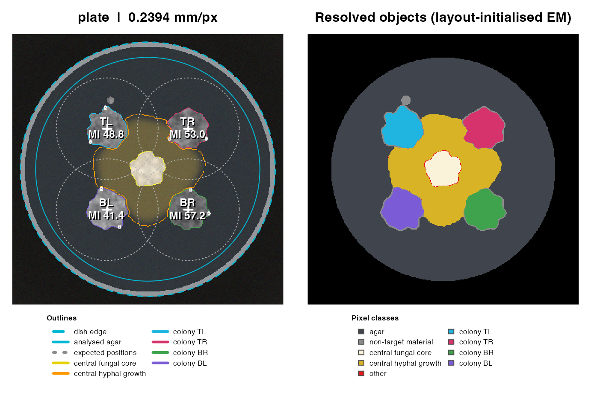

# Get started with FunMel

## What the package measures

The standard assay has four *Zymoseptoria tritici* target colonies
around another fungus. The central fungal core and its peripheral hyphal
growth are separated from Zymo before target measurements. These regions
represent image-based fungal tissue candidates. They are not an
inhibition boundary or evidence of pigment diffusion. The software
cannot distinguish species or microscopic hyphae from colour alone.
Contact between organisms may require manual interpretation.

Melanization index is `MI = 100 - CIELAB L*`, from 0 (white) to 100
(black). It measures image darkness, not melanin concentration.
Calibration, exposure, illumination and segmentation affect the result.

There are two complementary measurements:

| Measurement | Pixel selection | Where to find it |
|----|----|----|
| Whole-colony MI | All eligible interior pixels | `colonies`: `MI_min`, `MI_mean`, `MI_max` |
| Optional circular spots | A chosen number of spatially distributed ROIs | `spots`, plus `MI_spot_mean/min/max` in `colonies` |

The default matched coefficients use whole-colony `MI_mean`. Spots are
optional subsamples, not additional biological replicates.

## Install and open the package

``` r

install.packages("remotes")
remotes::install_github("mghotbi/FunMel")
library(FunMel)
```

R \>= 4.1 and a compilation toolchain are needed: Xcode Command Line
Tools on macOS, matching Rtools on Windows, or R development tools and
ImageMagick libraries on Linux. Restart R before updating a loaded
installation. To include the installed vignette:

``` r

remotes::install_github("mghotbi/FunMel",
                        build_vignettes=TRUE, dependencies=TRUE)
vignette("FunMel", package="FunMel")
```

Pandoc is required to build vignettes and is normally supplied by
RStudio.

## A first runnable image example

This simulated image demonstrates the commands without external files.
It is a computational example, not biological validation of real
photographs.

``` r

sim <- simulate_plate(width=400,height=400,seed=7)
result <- analyze_plate(sim$image, n_spots=3, spot_radius_mm=0.4,
                        n_boot=20, verbose=FALSE)
knitr::kable(result$colonies[,c("colony_id","MI_min","MI_mean","MI_max",
                               "n_spots_measured","MI_spot_mean","spot_status")],digits=2)
```

|     | colony_id | MI_min | MI_mean | MI_max | n_spots_measured | MI_spot_mean | spot_status |
|:----|:----------|-------:|--------:|-------:|-----------------:|-------------:|:------------|
| x   | TL        |  24.46 |   46.32 |  79.40 |                3 |        41.56 | ok          |
| x1  | TR        |  39.23 |   52.24 |  79.12 |                3 |        50.12 | ok          |
| x2  | BR        |  41.18 |   58.46 |  79.69 |                3 |        61.63 | ok          |
| x3  | BL        |  23.68 |   41.14 |  79.18 |                3 |        38.61 | ok          |

``` r

plot_qc(result)
```



White numbered circles show the optional sampling ROIs. Inspect them
along with the colony and central-growth masks before using results.
Controls use `plate_layout(centre="none")`; the default confrontation
uses `centre="fungus"`.

## Follow the real 14-day photographs: step by step

The package includes **eight original photographs** in
`extdata/14-days`. They form two complete sets, each with one control
and three independent confrontation plates. Four Zymo colonies are
measured within each plate. No separate download or ZIP extraction is
needed.

| Set | Control photograph | Treatment photographs |
|----|----|----|
| `A60_2_14_days` | `2026_10_02_99_41.JPG` | `...38.JPG`, `...39.JPG`, `...40.JPG` |
| `B20_2_14_days` | `2026_10_02_99_45.JPG` | `...42.JPG`, `...43.JPG`, `...44.JPG` |

### Step 1. Prepare the example project

``` r

library(FunMel)
photos14 <- system.file("extdata", "14-days", package="FunMel")
stopifnot(nzchar(photos14))
project14 <- prepare_experiment(photos14, "FunMel_14_day_project")
project14$metadata_file
```

The last line prints the location of **`plate_metadata.csv`**. Open that
file in Excel, LibreOffice or a text editor. Edit the project copy, not
the installed example. Keep it as CSV when saving. Use a new project
folder name to start over; existing projects are not overwritten.

### Step 2. Check the experimental metadata

There are **eight rows: two control plates and six treatment plates**.
Check every row against laboratory records:

1.  Preserve `file`, `relative_file` and the unique `plate_id`.
2.  Verify `treatment` and `set_id`. Each control and its three
    treatment plates share one `set_id`. Enter the control once; do not
    duplicate it per treatment.
3.  Use `centre_model="none"` for controls and `centre_model="fungus"`
    for confrontations. Check `day=14`, replicate labels and recorded
    strain/medium.
4.  Set `metadata_confirmed` to `TRUE` for verified rows, then save the
    CSV. This confirmation is required to protect treatment-to-control
    matching.

Folder codes and the supplied `fungus="hm83"` field require biological
interpretation from records. The example does not invent strain, medium
or partner identities. Additional metadata columns are retained
automatically. Leave `qc_pass=FALSE` until a plate’s image analysis has
been reviewed; this flag is an optional record of QC approval, not a
default calculation gate.

### Step 3. Measure the photographs

Enter the actual **outer dish diameter in millimetres** when prompted.
All images in this run use that scale; use separate runs for different
dish sizes.

``` r

dish_mm <- as.numeric(readline("Actual outer dish diameter in mm: "))
stopifnot(length(dish_mm)==1L, is.finite(dish_mm), dish_mm>0)
result14 <- run_experiment(
  project14, dish_diameter_mm=dish_mm, max_dim=1200,
  n_spots=5, spot_radius_mm=0.4
)
result14$failed
project14$qc_dir
```

This keeps whole-colony MI and requests five circular sampling spots per
target colony. Omit `n_spots` and `spot_radius_mm` for whole-colony
measurements alone. Check `spot_status`: five non-overlapping spots may
not fit every usable colony. The default final coefficient uses
whole-colony `MI_mean`, not the spot means. Resolve any rows in
`result14$failed` before finalization.

### Step 4. Inspect the QC images

The last command prints the QC folder. Open it in Finder or File
Explorer and inspect **all eight PNGs**. Check that:

- Target outlines follow the visible Zymo colony boundaries.
- Central fungal tissue, surrounding hyphae, shadows and agar are
  excluded from target measurements; controls have no central fungus
  assigned.
- Optional sampling circles lie inside the correct colonies. Review
  scale, exposure, illumination, insufficient-spot and other warnings.

Correct unsuitable settings and rerun Step 3 when necessary. A new run
resets `qc_pass=FALSE` because the new masks have not been reviewed. Do
not rerun image analysis merely to load an edited review CSV.

**QC approval is optional by default.** You may record `qc_pass=TRUE` in
the CSV for each acceptable, reviewed plate. If any flags remain
`FALSE`, are missing or unknown, finalization warns and continues. It
keeps the flags unchanged, reports unconfirmed QC and labels the figure
caption. This is a reminder to review before interpreting or publishing,
not automatic validation of the masks.

### Step 5. Calculate and export the results

``` r

reviewed14 <- finish_experiment(project14)
reviewed14$melanization_coefficient
reviewed14$qc_review
reviewed14$assessment$status
```

`metadata_confirmed=TRUE` is still required for each included row. A
warning about unconfirmed image QC does not stop the default
calculation. A warning about fewer than two plates in a set-treatment
cell means that this example has one control per set: it supports
descriptive ratios, not inferential tests. The four colonies per plate
and the individual spots are subsamples, not extra independent controls.

Open these files in `FunMel_14_day_project`:

| File | Contents |
|----|----|
| `metadata_used.csv` | Complete metadata, including original QC flags and custom fields |
| `qc_review_status.csv` | Whether QC was confirmed and which plates remain unconfirmed |
| `colonies.csv`, `spots.csv` | Colony summaries and individual sampling ROIs |
| `melanization_coefficient.csv` | Treatment MI divided by its own set’s control MI, with QC status |
| `treatment_comparison.pdf`, `.svg`, `.png` | Exported comparison figure; caption identifies unconfirmed QC |

A ratio above 1 means darker target colonies than the matching control;
below 1 means lighter. This is image darkness, not measured melanin
concentration. Each treatment occurs in one set, so batch effects can
remain confounded with treatment even after control adjustment. Review
design, warnings and diagnostics before drawing biological conclusions.

**Optional strict QC:** after setting `qc_pass=TRUE` only for
acceptable, reviewed plates and saving the CSV, use:

``` r

reviewed14 <- finish_experiment(project14, require_qc=TRUE)
```

Strict mode stops if any included plate lacks explicit QC approval. The
default is `require_qc=FALSE`; it does not require you to change QC
flags to calculate.

### Step 6. Resume after restarting R

``` r

library(FunMel)
project14 <- readRDS("FunMel_14_day_project/project.rds")
result14 <- readRDS(project14$result_file)
# After editing and saving metadata, reuse the saved measurements:
reviewed14 <- finish_experiment(project14)
```

Use the full project path if your working directory has changed. A
companion R script is at
`system.file("examples", "walkthrough_14_days.R", package="FunMel")`;
open it and run each numbered section separately.

For your own images, replace `photos14` in Step 1 with a photograph
folder path, or
[`file.choose()`](https://rdrr.io/r/base/file.choose.html) to select a
ZIP. Supply metadata that describes those images; the bundled eight-row
template applies only to the eight example photographs. The original
20-photo archive needs a matching 20-row metadata table and is not
interchangeable with this eight-photo teaching subset.

## Analyze an experiment in three stages

### Stage 1: prepare photographs and metadata

A ZIP can contain any number of batches, each with control and treatment
subfolders. For example:

| Folder                  | Images                                          |
|-------------------------|-------------------------------------------------|
| `day8/batch1/control/`  | Control plates for this day and batch           |
| `day8/batch1/fungus_A/` | Replicate treatment plates using those controls |
| `day8/batch2/control/`  | A different matching control set                |
| `day8/batch2/fungus_B/` | Replicate treatment plates for batch 2          |

An enclosing ZIP folder is supported. Images with identical basenames in
different folders remain distinct through their relative paths. A unique
`plate_metadata.csv` inside the ZIP can supply the design. Otherwise
folder labels propose a template for review. Only explicit `control` or
`controls` folders count as proposed controls; customize
`control_folders` if necessary. An ambiguous folder layout leaves
treatment labels blank rather than guessing.

``` r

project <- prepare_experiment(file.choose(), "FunMel_project")
# Or supply a directory:
# project <- prepare_experiment("path/to/photos", "FunMel_project")
project$metadata_file
```

Open that CSV in a spreadsheet editor. Preserve `file`, `relative_file`
and `plate_id`. Verify `set_id`, `treatment` and `centre_model`. Use
`control` and `centre_model="none"` for a control; use the experimental
treatment name and `centre_model="fungus"` for fungal confrontations.
The optional `partner_type` records biology separately from the
computational recipe. Set `metadata_confirmed=TRUE` after checking
assignments; leave `qc_pass=FALSE` until reviewing image masks. Both
columns are present in the template.

**Each treatment uses its own control set.** One control and three
independent treatment plates require four metadata rows with the same
`set_id`. The single control is entered once, not copied three times:

``` r

metadata_example <- data.frame(
  plate_id=c("C1","T1","T2","T3"),set_id="batch1",
  treatment=c("control",rep("fungus_A",3)),
  centre_model=c("none",rep("fungus",3)),
  metadata_confirmed=FALSE,qc_pass=FALSE)
knitr::kable(metadata_example)
```

| plate_id | set_id | treatment | centre_model | metadata_confirmed | qc_pass |
|:---------|:-------|:----------|:-------------|:-------------------|:--------|
| C1       | batch1 | control   | none         | FALSE              | FALSE   |
| T1       | batch1 | fungus_A  | fungus       | FALSE              | FALSE   |
| T2       | batch1 | fungus_A  | fungus       | FALSE              | FALSE   |
| T3       | batch1 | fungus_A  | fungus       | FALSE              | FALSE   |

Different strains, days or media require separate set IDs and explicit
context columns (`zymo_strain`, `day`, `medium`). Add and fill the
relevant columns in the CSV; folder paths alone do not define
statistical context variables. Finalization separates recorded contexts
into indexed output folders. Repeated photographs of the same plate on
different days are repeated measures, not independent replicates; the
built-in model does not estimate a longitudinal response.

### Stage 2: analyze, then inspect every plate

``` r

# Whole-colony measurements only:
result <- run_experiment(project, dish_diameter_mm=90)

# Alternative: retain whole-colony MI and add five circular spots per target:
result <- run_experiment(project, dish_diameter_mm=90,
                         n_spots=5, spot_radius_mm=0.4)
```

Run one of the alternatives. The dish diameter is the actual outer dish
diameter; do not assume 90 mm if a different dish was used. The project
saves measurements, QC figures and `image_analysis.rds`. Failures remain
in `failed.csv`. Coefficients are calculated during finalization after
experimental metadata confirmation; unconfirmed image QC warns by
default.

Inspect all QC PNGs in `project$qc_dir`. Check target outlines, central
core and hyphal growth, sampling circles, exposure, scale and
illumination warnings. Correct unsuitable settings and rerun if
necessary. Each new run resets `qc_pass=FALSE` so changed masks require
a new review. Save per-plate review decisions in the CSV.
`metadata_confirmed` must be logical `TRUE` for every included plate.
Unconfirmed `qc_pass` warns and continues by default;
`finish_experiment(project, require_qc=TRUE)` instead requires explicit
QC approval. Do not mark unresolved masks as passed merely to obtain a
number.

### Stage 3: finalize and export

``` r

reviewed <- finish_experiment(project)
```

Finalization loads the saved image analysis and reviewed CSV. It
requires confirmed experimental metadata, exact plate-ID matching and no
unresolved failed images. Image QC warns by default; `require_qc=TRUE`
makes QC approval mandatory. Editing metadata review flags does not
repeat image processing. Changing segmentation settings requires a new
image analysis.

Outputs include `colonies.csv`, `spots.csv`, `profiles.csv`,
`plates.csv`, `melanization_coefficient.csv`, per-plate ratios, saved
assessment and session information. Comparison figures are exported as
PDF, SVG and 600-dpi PNG, with statistics CSVs. When context columns
vary, consult `context_index.csv` and its separate context folders for
figures and assessment objects.

To resume after restarting R:

``` r

project <- readRDS("FunMel_project/project.rds")
result <- readRDS(project$result_file)
# After editing the review CSV:
reviewed <- finish_experiment(project)
```

## Choose and interpret sampling spots

`n_spots` is the requested number per target colony; `spot_radius_mm`
sets ROI size. Farthest-point placement gives reproducible spatial
spread, beginning near the eligible-mask centroid. ROIs cannot overlap
and must lie entirely within the usable, edge-excluded target mask.
Specular/saturated pixels are excluded. This is a spatial sample, not a
probability sample or a guarantee that a few spots represent the entire
colony.

If the placement algorithm cannot fit the requested ROIs, the achieved
spots remain available for inspection,
`spot_status="insufficient_space"`, and the colony’s spot summary is
`NA`. Adjust count/radius consistently across compared plates and rerun;
changing only selected colonies can change the estimand. Small ROIs must
span at least one working-image pixel in radius. Very small ROIs and raw
extrema are particularly sensitive to image noise.

``` r

knitr::kable(head(result$spots),digits=2)
```

| plate_id | colony_id | spot_id | x_px | y_px | spot_radius_mm | n_pixels | MI_mean | MI_min | MI_max | L_mean |
|:---|:---|---:|---:|---:|---:|---:|---:|---:|---:|---:|
| plate | TL | 1 | 141 | 141 | 0.4 | 9 | 48.18 | 44.31 | 52.33 | 51.82 |
| plate | TL | 2 | 116 | 122 | 0.4 | 9 | 49.51 | 47.11 | 51.35 | 50.49 |
| plate | TL | 3 | 167 | 126 | 0.4 | 9 | 26.98 | 24.46 | 28.58 | 73.02 |
| plate | TR | 1 | 260 | 141 | 0.4 | 9 | 49.66 | 46.70 | 54.90 | 50.34 |
| plate | TR | 2 | 234 | 125 | 0.4 | 9 | 49.65 | 43.89 | 76.50 | 50.35 |
| plate | TR | 3 | 289 | 133 | 0.4 | 9 | 51.04 | 45.87 | 75.80 | 48.96 |

In `spots`, each ROI has pixel-level `MI_min/mean/max`. In `colonies`,
`MI_spot_min/mean/max` summarize the **spot means**, with equal weight
per spot. The whole-colony `MI_min/mean/max` use all eligible interior
pixels, and do not change when spots are requested. Minima/maxima are
observed extrema, not error bars or confidence intervals. Spatial
block-bootstrap intervals are conditional on the image and mask and do
not describe biological plate replication.

For a prespecified spot-based descriptive analysis:

``` r

spot_coefficients <- melanization_coefficient(reviewed, response="MI_spot_mean")
```

Keep the measurement method explicit. The default final assessment and
figures use whole-colony MI; spots are not automatically substituted
into that model.

## Matched coefficients and statistical assessment

A plate’s MI is the arithmetic mean of its target-colony `MI_mean`
values. The melanization coefficient is the mean treatment plate MI
divided by the mean control plate MI from the same `set_id`. Plates are
equally weighted, and a shared control remains one control. Ratios
describe darkness indices, not ratios of melanin concentrations. MI
differences and ratios answer different questions; neither proves an
effect on pigment biochemistry.

The following dataset is synthetic and has three independent plates per
control/treatment cell in three matched sets:

``` r

demo <- example_experiment(seed=42)
assessment <- assess_experiment(demo)
knitr::kable(assessment$coefficients[,c("set_id","treatment",
                                      "melanization_coefficient")],digits=3)
```

| set_id | treatment | melanization_coefficient |
|:-------|:----------|-------------------------:|
| S1     | fungus_A  |                    1.105 |
| S1     | fungus_B  |                    1.248 |
| S2     | fungus_A  |                    1.154 |
| S2     | fungus_B  |                    1.360 |
| S3     | fungus_A  |                    1.113 |
| S3     | fungus_B  |                    1.224 |

``` r

assessment$status
#> [1] "ok"
```

``` r

plot_treatment_comparison(demo)
```


Control plates use outlined squares and treatment plates use coloured
circles. Bars span between-plate SD, not inferential CIs. Coefficient SD
is conditional on the shared control mean and excludes denominator
uncertainty. The separate model contrast covariance retains
shared-control uncertainty for inference.

With one control and three treatment plates per set, descriptive
coefficients are available but the built-in inference guard is not met.
`lme4`/`lmerTest` models require adequate independent plate replication,
acceptable convergence, non-singular fits and suitable residuals. Spots,
pixels, rings and target colonies are nested measurements; none creates
extra independent plates. Sparse or problematic designs return an
explicit descriptive-only status. Inspect `assessment$diagnostics` and
the inferential tables rather than interpreting absence of a p value as
absence of an effect.

### Metadata columns are preserved

Templates include `file`, `relative_file`, `plate_id`, `set_id`,
`treatment`, `centre_model`, `partner_type`, `fungus`, `zymo_strain`,
`medium`, `day`, `replicate`, `photo_date`, `notes`,
`metadata_confirmed` and `qc_pass`. Experimental values are left blank
when unknown; both review flags start as `FALSE`. Additional
user-defined columns are retained, including their names and values. A
new image-analysis run resets `qc_pass` to `FALSE`; review the new
measurements. Default finalization warns and continues without changing
these flags. Use `require_qc=TRUE` when QC approval must be mandatory.

A context column (`day`, `medium` or `zymo_strain`) may be entirely
blank when not recorded. Once any value is entered, complete that column
for all plates and keep it constant within each matching set. Do not
leave a varying context unrecorded to combine incompatible experiments.

The full table is stored in `result$metadata` and exported as
`metadata_used.csv`. Additional fields are also attached to measurement
tables by `plate_id`. If a metadata name conflicts with a measured
column, the measurement is protected and the metadata copy receives a
`metadata_` prefix in that output table. The original names remain
unchanged in the full metadata table.

## Resolve common problems

| Situation | Action |
|----|----|
| Missing/blank treatment labels | Complete the metadata; folder proposals are not biological proof |
| Missing control | Assign the actual relevant control within each set; never borrow a different batch’s control |
| Duplicate photograph basenames | Preserve `relative_file`, which includes batch folders |
| Requested spots do not fit | Inspect `spot_status`; adjust settings consistently and reanalyze |
| Central hyphae overlap a target | Review separation and consider manual analysis if the photograph cannot resolve it |
| `qc_pass` remains FALSE | Default finalization warns and continues, retaining unconfirmed status. Inspect QC before interpretation; optionally record reviewed decisions or enforce `require_qc=TRUE`. |
| Changed segmentation settings | Rerun image analysis; old review flags do not validate new masks |
| Descriptive-only assessment | Review the replication/design and model diagnostics |

## More examples and algorithm details

``` r

source(system.file("examples","01_image_quickstart.R",package="FunMel"))
source(system.file("examples","02_coefficient_arithmetic.R",package="FunMel"))
source(system.file("examples","05_project_workflow.R",package="FunMel"))
```

The bundled 14-day measurement tables are a provisional measured case
study with two sets, each containing one control and three treatment
plates. Their experimental assignments and masks require review; they
are not a validated biological reference or a basis for claiming general
accuracy. Synthetic tests verify computational behavior, not biological
discrimination across all fungi.

The separate `guides/FunMel_overview.md` describes the image features,
watershed separation, spot sampling and matched-set inference.
ImageJ/Fiji remains useful for manual ROI analysis and difficult
boundaries; no superiority in accuracy or speed is claimed.
