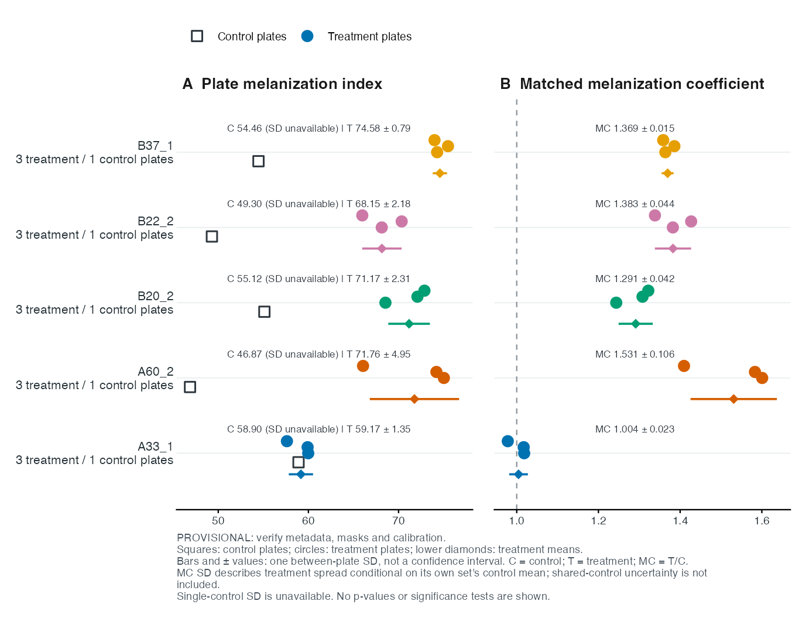
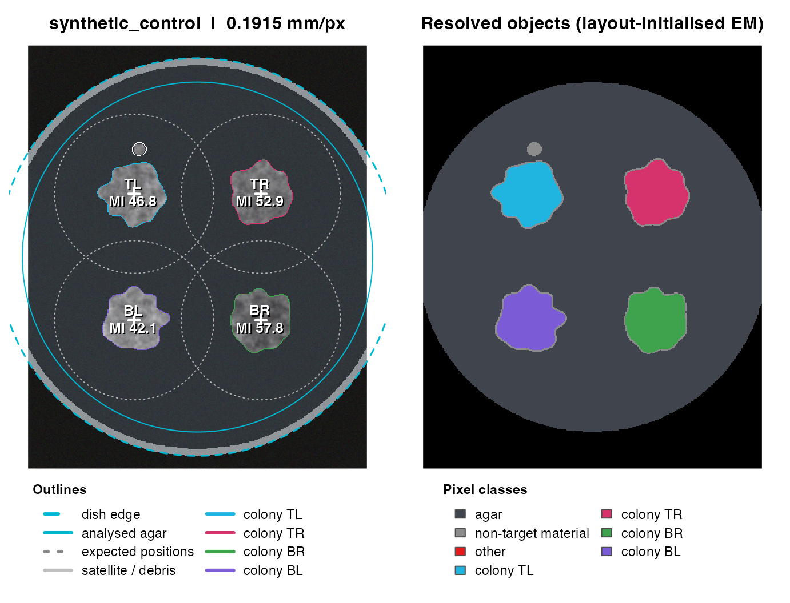
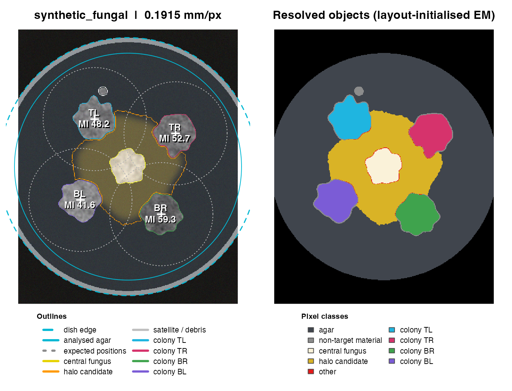
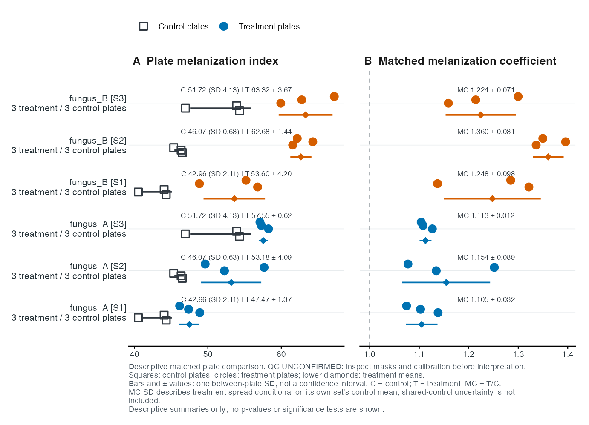

# Get started with FunMel

## From a plate photograph to a matched response

This guide introduces the FunMel workflow: analyze plate photographs,
inspect segmentation masks, organize experimental metadata, calculate
matched-control melanization coefficients, assess treatment effects and
export comparison figures. FunMel retains the original MycoHalo
functions for compatibility.

The first worked example uses a bundled measured dataset from a 14-day
confrontation assay. Subsequent examples use simulated plates and
measurements to demonstrate image analysis and statistical methods. All
runnable examples in this guide use bundled or simulated inputs; no
photograph download is needed.

The default assay has four approximately round *Zymoseptoria tritici*
colonies surrounding a central fungal colony and its halo candidate.
Target-colony MI quantifies darkness in the four *Z. tritici* colonies.
The central fungus and halo are measured separately and excluded from
those MI summaries. A known inoculation layout supplies search regions
and seeds. Detected outlines need not be round. These are image classes,
not automated species identification. A central colour zone is a halo
candidate, not a confirmed inhibition boundary.

> **The assay at a glance**  
> Four target *Zymoseptoria tritici* colonies surround a central fungal
> colony. FunMel measures target-colony darkness and geometry, separates
> the central partner and halo candidate, and compares each treatment
> with its own controls.

### Follow the workflow

| Step | Action | Result |
|:---|:---|:---|
| **1 · Analyze** | Set the plate layout and dish diameter | Target-colony measurements |
| **2 · Review** | Inspect masks, calibration and warnings | Documented quality decisions |
| **3 · Match** | Identify independent plates and their control sets | Verified experimental metadata |
| **4 · Compare** | Calculate matched coefficients and assess a supported model | Descriptive responses and, when justified, inference |
| **5 · Communicate** | Export plate-level figures and tables | Traceable results for reporting |

**Three essentials before starting:** MI is an image-darkness proxy, not
melanin concentration. Colonies within a dish are subsamples, not
independent plates. Each treatment uses only the controls assigned to
its matching set.

## Install FunMel

Install a GitHub-hosted copy of the package using `remotes`. R \>= 4.1
and source-compilation tools are required: Xcode Command Line Tools on
macOS, the matching Rtools release on Windows, or an R development
toolchain and ImageMagick development libraries on Linux.

``` r

install.packages("remotes")
remotes::install_github("mghotbi/FunMel")
library(FunMel)
```

The source repository is
[mghotbi/FunMel](https://github.com/mghotbi/FunMel). The default
installation uses its default branch. To select a release tag or another
branch, add `ref="TAG_OR_BRANCH"`.

To include the locally installed vignette:

``` r

install.packages(c("remotes", "knitr", "rmarkdown"))
remotes::install_github("mghotbi/FunMel",
                        build_vignettes=TRUE, dependencies=TRUE)
vignette("FunMel", package="FunMel")
```

Vignette building requires Pandoc, normally supplied with RStudio.
Private repositories require GitHub authentication. Restart R before
replacing a loaded FunMel installation. For a downloaded source archive,
use `install.packages(file.choose(), repos=NULL, type="source")`
instead.

## Explore the measured 14-day case study

The bundled 14-day dataset contains twenty photographs organized into
five matching sets. Each set contains one control dish and three
treatment dishes, with four target *Z. tritici* colonies per dish.
Metadata has twenty plate rows; the measurement table has eighty colony
rows. This design is used to demonstrate shared-control matching. Other
experiments may have different replicate counts and control
arrangements, which must be recorded explicitly in their metadata.

``` r

real_meta <- read.csv(system.file("extdata","14_day_example","metadata.csv",
                                 package="FunMel"),stringsAsFactors=FALSE)
real_colonies <- read.csv(system.file("extdata","14_day_example","colonies.csv",
                                     package="FunMel"),stringsAsFactors=FALSE)
validate_metadata(real_meta)
knitr::kable(real_meta[real_meta$set_id=="A33_1_14_days",
                       c("file","plate_id","set_id","treatment","replicate")])
```

| file                 | plate_id         | set_id        | treatment | replicate |
|:---------------------|:-----------------|:--------------|:----------|----------:|
| 2026_10_02_99_28.JPG | 2026_10_02_99_28 | A33_1_14_days | control   |         1 |
| 2026_10_02_99_29.JPG | 2026_10_02_99_29 | A33_1_14_days | A33_1     |         1 |
| 2026_10_02_99_31.JPG | 2026_10_02_99_31 | A33_1_14_days | A33_1     |         2 |
| 2026_10_02_99_32.JPG | 2026_10_02_99_32 | A33_1_14_days | A33_1     |         3 |

The same four-row structure applies to A60, B20, B22 and B37, with each
set’s own control. The control replicate is 1 and the three treatment
replicates are 1–3. Replicate numbers do not define one-to-one pairing
here: all three treatment plates use their set’s single control.
Folder-derived treatment identities and experimental mappings are
provisional. Each control dish appears once in the metadata and serves
as the denominator for all treatment plates in its set.

View measurements from all 20 independent plates

``` r

real_plate_means <- aggregate(MI_mean ~ plate_id + set_id + treatment,
                             data=real_colonies,FUN=mean)
knitr::kable(real_plate_means,digits=2)
```

| plate_id         | set_id        | treatment | MI_mean |
|:-----------------|:--------------|:----------|--------:|
| 2026_10_02_99_29 | A33_1_14_days | A33_1     |   59.98 |
| 2026_10_02_99_31 | A33_1_14_days | A33_1     |   59.91 |
| 2026_10_02_99_32 | A33_1_14_days | A33_1     |   57.62 |
| 2026_10_02_99_38 | A60_2_14_days | A60_2     |   75.03 |
| 2026_10_02_99_39 | A60_2_14_days | A60_2     |   74.20 |
| 2026_10_02_99_40 | A60_2_14_days | A60_2     |   66.06 |
| 2026_10_02_99_42 | B20_2_14_days | B20_2     |   68.54 |
| 2026_10_02_99_43 | B20_2_14_days | B20_2     |   72.09 |
| 2026_10_02_99_44 | B20_2_14_days | B20_2     |   72.87 |
| 2026_10_02_99_48 | B22_2_14_days | B22_2     |   68.14 |
| 2026_10_02_99_49 | B22_2_14_days | B22_2     |   70.35 |
| 2026_10_02_99_50 | B22_2_14_days | B22_2     |   65.98 |
| 2026_10_02_99_34 | B37_1_14_days | B37_1     |   74.28 |
| 2026_10_02_99_36 | B37_1_14_days | B37_1     |   75.48 |
| 2026_10_02_99_37 | B37_1_14_days | B37_1     |   73.99 |
| 2026_10_02_99_28 | A33_1_14_days | control   |   58.90 |
| 2026_10_02_99_41 | A60_2_14_days | control   |   46.87 |
| 2026_10_02_99_45 | B20_2_14_days | control   |   55.12 |
| 2026_10_02_99_47 | B22_2_14_days | control   |   49.30 |
| 2026_10_02_99_33 | B37_1_14_days | control   |   54.46 |

These are measured image-darkness values rather than simulated outputs.
Interpretation as biological treatment responses requires verification
of experimental assignments, segmentation masks and colour calibration.
The bundled example retains its provisional review status.

``` r

plot_treatment_comparison(real_colonies,preview=TRUE)
```



For each set, the displayed coefficient is
`mean(MI_T1, MI_T2, MI_T3) / MI_control`. This descriptive coefficient
permits one control plate. The built-in inferential assessment has a
separate replication guard and does not treat four control colonies as
four control plates. Replicate ratios share control uncertainty; their
spread is not a full ratio confidence interval.
`metadata_confirmed=FALSE` is retained, so the figure is clearly
provisional and final coefficient calculation remains blocked until
review.

``` r

source(system.file("examples","04_14_day_case_study.R",package="FunMel"))
file.copy(system.file("examples","metadata_14_day_case_study.csv",package="FunMel"),
          "case_study_metadata.csv",overwrite=FALSE)
```

The case-study metadata illustrates one row per independent plate and
explicit matching-set assignments. The following sections use synthetic
data to explain image analysis and statistical calculations step by
step.

## 1. Analyze and review a plate

``` r

lay <- plate_layout(centre="none")
sim <- simulate_plate(width=400,height=500,layout=lay,seed=21)
control <- analyze_plate(sim$image,layout=lay,id="synthetic_control",
                         n_boot=20,verbose=FALSE)
control$colonies[,c("colony_id","detected","MI_mean","area_mm2")]
#>    colony_id detected  MI_mean area_mm2
#> x         TL     TRUE 46.76874 155.3031
#> x1        TR     TRUE 52.94210 154.8631
#> x2        BR     TRUE 57.78119 154.8631
#> x3        BL     TRUE 42.08680 155.5230
plot_qc(control)
```



There is one measurement row per target colony. The overlay shows
boundaries and labels; the resolved-object panel shows the assigned
regions. Four detected regions are not proof of four correct biological
objects. Check dish scale, colony boundaries, reflections,
central-object assignment and warnings.

``` r

fungal_layout <- plate_layout(centre="fungus",rotation_deg=10)
fungal_sim <- simulate_plate(width=400,height=500,layout=fungal_layout,seed=22)
confrontation <- analyze_plate(fungal_sim$image,layout=fungal_layout,
                               id="synthetic_fungal",n_boot=20,verbose=FALSE)
confrontation$plate_summary[,c("central_partner_type","central_detected","halo_status")]
#>   central_partner_type central_detected        halo_status
#> x               fungus             TRUE candidate_detected
plot_qc(confrontation)
```



For fungal confrontation photographs, use `centre="fungus"`; control
plates use `centre="none"`. Pass an image path rather than `sim$image`
and enter the actual dish diameter:

``` r

img <- file.choose()
r <- analyze_plate(img,layout=plate_layout(centre="fungus"),
                   dish_diameter_mm=90,keep_images=TRUE)
plot_qc(r)
r$warnings
```

`keep_images=TRUE` allows later QC plotting. Batch results save QC PNGs
but drop large image arrays. Mean MI is `100 - L*` on retained,
non-specular colony-interior pixels: higher MI means darker images, not
measured pigment concentration.

## 2. Set the inoculation layout

``` r

plate_layout(centre="fungus",rotation_deg=15,radius_frac=0.5)
#> <funmel_layout> 4 fungal colonies; centre: fungus
#>  id  x_rel  y_rel
#>  TL -0.250 -0.433
#>  TR  0.433 -0.250
#>  BR  0.250  0.433
#>  BL -0.433  0.250
positions <- data.frame(id=c("N","E","S","W"),
                        x_rel=c(0,0.5,0,-0.5),y_rel=c(-0.5,0,0.5,0))
plate_layout(centre="fungus",positions=positions)
#> <funmel_layout> 4 fungal colonies; centre: fungus
#>  id x_rel y_rel
#>   N   0.0  -0.5
#>   E   0.5   0.0
#>   S   0.0   0.5
#>   W  -0.5   0.0
```

Coordinates are relative to the dish radius: x increases rightward and y
downward. `radius_mm` can set physical inoculation spacing.
`search_frac` controls core-search radius. Do not enlarge it
indiscriminately to capture unrelated growth. Optional numeric
`rotation_deg`, `radius_frac`, `radius_mm`, `search_frac`, `start_deg`
and `n_colonies` metadata columns are read by
[`layout_by_treatment()`](https://mghotbi.github.io/FunMel/reference/layout_by_treatment.md).
Explicit layout arguments take priority. Arbitrary image names and
supported layouts are allowed; severely merged colonies, reflections or
uncertain class identity still need review/training or manual analysis.

## 3. Match treatments to their controls

One row is one independently prepared dish photographed once. Four
colonies on one plate are subsamples. Multiple photographs of the same
dish are repeated observations, not independent biological replicates.

| Field | Required interpretation |
|----|----|
| `file`, `relative_file` | Unique basename and optional path from the photo root |
| `plate_id` | Unique biological plate ID |
| `set_id` | Matching control set, often a batch |
| `treatment` | `control` or a consistent intervention name |
| `centre_model` | `none` for controls; `fungus` for fungal confrontation |
| `partner_type` | Biological partner type |
| `zymo_strain`, `day`, `medium` | Recommended context, complete and constant within a set if supplied |
| `metadata_confirmed` | TRUE after experimental mapping is verified |
| `qc_pass` | TRUE after acceptable mask and calibration review; required for finalization |

A treatment in S1 uses only S1 controls. Separate treatment-control
experiments need separate set IDs. Several treatments can legitimately
share controls within one batch: put all those plates in one set and
list each control once. Do not copy a shared control under new plate
IDs. The same treatment label across sets must mean the same
intervention. Set IDs need not be folder names.

``` r

demo <- example_experiment(seed=42)
# Assign fungal labels to the two simulated treatment groups.
fungal_labels <- stats::setNames(c("fungus_A", "fungus_B"),
  setdiff(unique(as.character(demo$metadata$treatment)), "control"))
for (component in c("metadata", "colonies")) {
  d <- demo[[component]]
  d$treatment <- ifelse(d$treatment == "control", "control",
    fungal_labels[as.character(d$treatment)])
  for (field in intersect(c("centre_model", "partner_type"), names(d)))
    d[[field]] <- ifelse(d$treatment == "control", "none", "fungus")
  demo[[component]] <- d
}
validate_metadata(demo$metadata)
with(demo$metadata,table(set_id,treatment))
#>       treatment
#> set_id control fungus_A fungus_B
#>     S1       3        3        3
#>     S2       3        3        3
#>     S3       3        3        3
knitr::kable(head(demo$metadata[,c("file","plate_id","set_id","treatment","centre_model")]))
```

| file     | plate_id | set_id | treatment | centre_model |
|:---------|:---------|:-------|:----------|:-------------|
| P001.jpg | P001     | S1     | control   | none         |
| P002.jpg | P002     | S1     | control   | none         |
| P003.jpg | P003     | S1     | control   | none         |
| P004.jpg | P004     | S1     | fungus_A  | fungus       |
| P005.jpg | P005     | S1     | fungus_A  | fungus       |
| P006.jpg | P006     | S1     | fungus_A  | fungus       |

This synthetic design has three shared-control batches, each with
control, `fungus_A` and `fungus_B` and three independent plates per
group. Its true MI increments are 8 and 15, with added plate and colony
variation. Plate IDs are unambiguous; treatment C must not reuse an ID
like C1 that also names a control.

``` r

make_metadata("photos",recursive=TRUE)
# Edit photos/plate_metadata.csv: fill experimental fields, do not guess them.
meta <- read.csv("photos/plate_metadata.csv",stringsAsFactors=FALSE)
files <- file.path("photos",meta$relative_file)
validate_metadata(meta,files)
# Alternative for any original photo ZIP, including enclosing folders:
files <- prepare_photo_archive("original_photos.zip",meta,"extracted_photos")
```

### Review metadata before finalization

1.  **Load the completed metadata table.** Each row represents one
    independent plate. The template includes logical
    `metadata_confirmed` and `qc_pass` columns, both initially `FALSE`.

    ``` r

    metadata <- read.csv("photos/plate_metadata.csv", stringsAsFactors = FALSE)
    ```

2.  **Review the image analysis and experimental assignments.** Inspect
    each plate’s target-colony masks, central fungus and halo candidate,
    calibration and warnings. Verify the treatment label and `set_id`
    linking the plate to its matching controls. Mark only plates whose
    QC has passed, and separately confirm their experimental metadata.
    Replace the example IDs below with the actual plate IDs:

    ``` r

    reviewed_ids <- c("plate_1", "plate_2")
    metadata$qc_pass[metadata$plate_id %in% reviewed_ids] <- TRUE

    confirmed_ids <- c("plate_1", "plate_2")
    metadata$metadata_confirmed[metadata$plate_id %in% confirmed_ids] <- TRUE
    ```

3.  **Save the reviewed metadata and finalize.** Both flags must be
    logical `TRUE` for every included plate, with no missing values. The
    metadata must match the analyzed plate IDs exactly. Resolve failed
    images and unacceptable QC before finalizing. Use `TRUE` and `FALSE`
    without quotation marks.

    ``` r

    write.csv(metadata, "plate_metadata_reviewed.csv", row.names = FALSE)
    reviewed <- finalize_analysis(result, metadata)
    ```

Here `result` is the batch result returned by
[`analyze_plates()`](https://mghotbi.github.io/FunMel/reference/analyze_plates.md);
use the actual object name from the analysis. The flags record completed
user review. Changing segmentation settings or the central-partner
recipe requires reanalysis.

The template records provenance but leaves unknown experimental fields
blank and `metadata_confirmed=FALSE`. Validation checks unique
files/plates, complete set IDs, controls within each set and constant
recorded matching contexts. Different strains, days or media should have
separate set IDs. Final pooling of multiple recorded contexts requires
an explicit `pool_contexts=TRUE` decision. It is not a default
biological recommendation.

The twenty-row case-study metadata is available as
`inst/examples/metadata_14_day_case_study.csv`, introduced at the start
of this guide. Use it as a worked example; create a separate metadata
table for each new experiment rather than reusing its assignments.

## 4. Calculate the melanization coefficient

Average target-colony MI within each plate, giving each colony equal
weight. Then average independent plate means within set and treatment,
giving each plate equal weight. The ratio is

``` math
MI_p=\frac{1}{n_p}\sum_j MI_{pj},\qquad
MC_{s,t}=\frac{\operatorname{mean}_{p\in(s,t)} MI_p}
{\operatorname{mean}_{p\in(s,control)} MI_p}.
```

``` r

d <- data.frame(plate_id=rep(c("C01","T01","T02","T03"),each=4),
                set_id="S1",treatment=rep(c("control","A","A","A"),each=4),
                colony_id=rep(c("TL","TR","BR","BL"),4),
                MI_mean=rep(c(40,48,52,56),each=4))
mc <- melanization_coefficient(d)
mc$plate_means
#>   plate_id treatment set_id MI_plate n_target_colonies n_colonies_used
#> 1      C01   control     S1       40                 4               4
#> 2      T01         A     S1       48                 4               4
#> 3      T02         A     S1       52                 4               4
#> 4      T03         A     S1       56                 4               4
#>   n_colonies_excluded
#> 1                   0
#> 2                   0
#> 3                   0
#> 4                   0
mc$per_plate_coefficients[,c("plate_id","melanization_coefficient")]
#>   plate_id melanization_coefficient
#> 1      T01                      1.2
#> 2      T02                      1.3
#> 3      T03                      1.4
mc$coefficients[,c("MI_treatment_mean","MI_control_mean","melanization_coefficient")]
#>   MI_treatment_mean MI_control_mean melanization_coefficient
#> 1                52              40                      1.3
```

The replicate ratios are 1.2, 1.3 and 1.4; the treatment coefficient is
`mean(48,52,56)/40 = 1.3`. Independent plate measurements remain
available for analysis. This is not a mean of position-specific ratios.
The partner is excluded using target flags/central IDs. Missing target
MI is an error by default; `na_action="omit"` is an explicit
documented-exclusion option. A whole unusable plate remains unavailable.
A nonpositive control denominator gives no ratio.

If a treatment occurs in several sets, its overall descriptive
coefficient is an equal-set mean of matched ratios, not a ratio against
pooled unrelated controls.

``` r

x <- data.frame(plate_id=c("C1","T1","C2","T2"),set_id=c("S1","S1","S2","S2"),
                treatment=c("control","A","control","A"),colony_id="TL",
                MI_mean=c(20,40,80,80))
z <- melanization_coefficient(x)$coefficients
z[,c("set_id","melanization_coefficient")]
#>   set_id melanization_coefficient
#> 1     S1                        2
#> 2     S2                        1
mean(z$melanization_coefficient) # 1.5; pooled 120/100 would be 1.2
#> [1] 1.5
```

A ratio of 1.3 is not evidence of 30% more melanin. MI is an
image-darkness proxy. Replicate-ratio SD/SE does not include uncertainty
in a shared control denominator.

## 5. Assess treatment effects

``` r

a <- assess_experiment(demo$colonies,comparison_scope="common_sets")
a$status
#> [1] "ok"
knitr::kable(a$overall_coefficients,digits=3)
```

| treatment | n_sets | mean_matched_coefficient | sd_across_sets | sets     |
|:----------|-------:|-------------------------:|---------------:|:---------|
| fungus_A  |      3 |                    1.124 |          0.027 | S1;S2;S3 |
| fungus_B  |      3 |                    1.278 |          0.073 | S1;S2;S3 |

``` r

# Preserve small p-values in the displayed tables; do not round them to zero.
format_tests <- function(x) {
  for(nm in intersect(c("p_value","p_adjusted"),names(x)))
    x[[nm]] <- base::format.pval(x[[nm]],digits=2,eps=0.001)
  x
}
knitr::kable(format_tests(a$overall_effects),digits=3)
```

| treatment | n_sets | sets     | estimate |    se |  df |  lower |  upper | p_value | p_adjusted |
|:----------|-------:|:---------|---------:|------:|----:|-------:|-------:|:--------|:-----------|
| fungus_A  |      3 | S1;S2;S3 |    5.819 | 1.353 |  18 |  2.977 |  8.661 | \<0.001 | \<0.001    |
| fungus_B  |      3 | S1;S2;S3 |   12.950 | 1.353 |  18 | 10.108 | 15.792 | \<0.001 | \<0.001    |

``` r

knitr::kable(format_tests(a$treatment_comparisons),digits=3)
```

| treatment_1 | treatment_2 | n_common_sets | sets_1 | sets_2 | comparison_scope | same_set_coverage | status | estimate | se | df | lower | upper | p_value | p_adjusted |
|:---|:---|---:|:---|:---|:---|:---|:---|---:|---:|---:|---:|---:|:---|:---|
| fungus_A | fungus_B | 3 | S1;S2;S3 | S1;S2;S3 | common_sets | TRUE | ok | -7.131 | 1.353 | 18 | -9.973 | -4.289 | \<0.001 | \<0.001 |

The descriptive ratios and inferential effects are different outputs.
The mixed model uses original colony MI with one random intercept per
independent plate:

``` math
MI_{spj}=\mu_{s,t(p)}+b_p+\epsilon_{spj},\quad
b_p\sim N(0,\sigma^2_{plate}),\quad \epsilon_{spj}\sim N(0,\sigma^2).
```

Every observed set-treatment cell has its own fixed mean. `lme4` fits
this model; `lmerTest` gives Satterthwaite contrast inference.
Within-set effects subtract that set’s control. A-versus-B compares
matched effects, preserving shared-control covariance. No test treats
treatment averages as biological replicates. An explicit
`method="plate_means"` fits the same cell-specific fixed means to one
arithmetic mean per plate; with unequal colony counts it need not match
the mixed model’s weighting exactly.

`comparison_scope="common_sets"` uses shared sets only; an absent common
set gives `no_common_sets`. The default `matched_effects` uses each
treatment’s observed sets and flags different coverage. A treatment
observed only in one batch cannot automatically be separated from
batch-specific effects. Holm-adjusted p values are reported separately
from unadjusted contrast-wise confidence intervals.

### How this relates to the usual treatment-plus-batch model

The confrontation-assay principle is retained: independent replicate
measurements, own-batch control normalization for interpretation, and
modelling that accounts for experimental structure. FunMel’s
cell-specific model estimates effects in observed sets; it does **not**
fit a common treatment effect across random batches. An additive model
instead assumes treatment differences are common across batches. For a
sufficiently crossed design, the following is an advanced alternative on
individual plate means, not treatment averages:

``` r

pm <- melanization_coefficient(demo$colonies)$plate_means
additive <- lm(MI_plate ~ treatment + factor(set_id),data=pm)
coef(additive)
#>       (Intercept) treatmentfungus_A treatmentfungus_B  factor(set_id)S2 
#>         41.756742          5.819055         12.949846          5.962451 
#>  factor(set_id)S3 
#>          9.513623
```

This example is separate from
[`assess_experiment()`](https://mghotbi.github.io/FunMel/reference/assess_experiment.md),
not an automatic fallback. Check estimability, residual variance and
whether a common treatment effect is scientifically justified. A
random-batch model such as
`lme4::lmer(MI_plate ~ treatment + (1 | set_id), data=pm)` additionally
requires an appropriate population-of-batches interpretation and enough
batches to estimate variance. Very few batches can make this unstable.
More complex factorial, longitudinal, spatial or heteroscedastic designs
need their own models.

### Replication and diagnostics

The built-in assessment requires at least two independent plates per
cell and within-plate replication for its mixed model. This is a
conservative computational guard, not a universal requirement of all
confrontation assays or proof of power. One control plate still permits
a descriptive ratio. Some sparse designs may support other justified
models; additional assumptions must not be hidden.

``` r

sparse <- suppressWarnings(assess_experiment(d))
sparse$status # insufficient_plate_replication
#> [1] "insufficient_plate_replication"
```

Singular fits, convergence problems and insufficient replication return
explicit status and withhold inferential tables. No significance test is
silently substituted.

``` r

a$diagnostics$plates_per_cell
#>    set_id treatment  cell n_plates
#> 1      S1   control C0001        3
#> 4      S1  fungus_A C0002        3
#> 7      S1  fungus_B C0003        3
#> 10     S2   control C0004        3
#> 13     S2  fungus_A C0005        3
#> 16     S2  fungus_B C0006        3
#> 19     S3   control C0007        3
#> 22     S3  fungus_A C0008        3
#> 25     S3  fungus_B C0009        3
a$diagnostics$variance_components
#>        grp        var1 var2     vcov    sdcor
#> 1   .plate (Intercept) <NA> 7.945878 2.818843
#> 2 Residual        <NA> <NA> 1.160049 1.077056
op <- par(mfrow=c(1,2))
plot(fitted(a$model),residuals(a$model),xlab="Fitted MI",ylab="Residual")
abline(h=0,lty=2)
qqnorm(residuals(a$model));qqline(residuals(a$model))
```


``` r

par(op)
```

Spatial block-bootstrap intervals describe within-image pixel sampling,
not plate-to-plate biological variation. Normality and equal residual
variance remain model assumptions. Account for review/exclusion
decisions and design limitations.

## 6. Process and finalize an experiment

``` r

out <- analyze_plates(files,metadata=meta,
                      layout=function(row) layout_by_treatment(row),
                      qc_dir="FunMel_results/qc")
saveRDS(out,"FunMel_results/image_analysis.rds")
out$failed
out$coefficient_error
# STOP and inspect every QC image, measurement warning and metadata mapping.
# Correct images/masks if needed. Then edit the CSV's confirmation/review flags.
reviewed_meta <- read.csv("photos/plate_metadata.csv",stringsAsFactors=FALSE)
reviewed <- finalize_analysis(out,reviewed_meta)
write.csv(reviewed$melanization_coefficient,
          "FunMel_results/matched_coefficients.csv",row.names=FALSE)
saveRDS(reviewed,"FunMel_results/reviewed_analysis.rds")
```

[`finalize_analysis()`](https://mghotbi.github.io/FunMel/reference/finalize_analysis.md)
requires explicit complete logical `metadata_confirmed=TRUE` and
`qc_pass=TRUE`. These record user decisions, not automatic biological
proof. It applies verified labels to saved measurements without
repeating image processing. A changed central-partner recipe or layout
requires reanalysis. Failed images must be resolved before finalization.
Do not silently discard an inconvenient replicate. The generic
`scripts/analyse_experiment.R` saves measurement tables, statuses and
session information and separates the review stage from final
assessment.

## 7. Export figures and statistics

``` r

plot_treatment_comparison(demo,
  labels=c(fungus_A="Fungal partner A",fungus_B="Fungal partner B"))
```



``` r

p <- plot_treatment_comparison(reviewed,file="FunMel_results/treatment_comparison")
# Vector PDF/SVG, 600-dpi PNG and _statistics.csv are written.
attr(p,"FunMel_statistics") # means, SDs, independent plate counts, descriptive delta_MI
```

Panel A displays independent plate MI means and matching controls. Panel
B displays treatment replicate ratios and the set’s ratio of means.
Outlined squares are controls; coloured circles are treatment plates.
Lower diamonds show treatment means, with bars spanning mean ± one
between-plate SD. Each row reports control and treatment mean MI,
treatment SD, coefficient and coefficient SD. A single control plate has
no estimable SD (shown as unavailable). Shared controls remain shared,
not new replicates. Coefficient SD measures treatment variability
conditional on the shared control mean; it excludes denominator
uncertainty. These SDs are not confidence intervals. The separate model
results from
[`assess_experiment()`](https://mghotbi.github.io/FunMel/reference/assess_experiment.md)
are needed for supported inferential comparisons. Inferential estimates
and confidence intervals are reported separately by
[`assess_experiment()`](https://mghotbi.github.io/FunMel/reference/assess_experiment.md)
when the design and model diagnostics support them. `preview=TRUE`
labels a provisional view; it never confirms metadata or overrides
failed QC. Figures need verified identities, adequate imaging and a
suitable caption before publication. Export settings do not establish
scientific validity.

## 8. Interpret outputs and resolve warnings

| Output | What it measures |
|----|----|
| `MI_mean`, `MI_median` | Target-colony image darkness |
| `area_mm2`, `circularity`, `solidity` | Detected mask geometry, conditional on scale and segmentation |
| `delta_MI_facing` | Facing-minus-away darkness difference within a target |
| `radial_asymmetry_pct` | Toward/away radial asymmetry; alias of legacy `growth_inhibition_pct` |
| `gap_partner_mm` | Geometric gap to the detected central partner |
| `profiles` | Distance-from-edge ring summaries, not independent plates |
| `halo_status` | Resolved colour-zone candidate or unresolved boundary |

Control-referenced growth inhibition is `(C - T)/C * 100`, with a
specified, consistent growth outcome (e.g. radius or area). It is
distinct from MI ratios and from radial asymmetry. FunMel’s matched
assessment currently targets MI; other outcomes and inhibition models
must be specified separately.

| Warning/status | Meaning and action |
|----|----|
| Fitted illumination range | Pre-correction green-channel surface range, not residual error |
| `flat_field_clipped_fraction` | Fraction of dish pixels where gains exceed correction limits; inspect calibration |
| `residual_agar_range_pct` | Remaining spatial-bin median variation on fitted agar pixels; not validated colony-level error |
| `segmentation_trim_fraction` | Narrow target/central connection removed; inspect the refined outline |
| Undetected colony | No adequate region found; do not invent MI |
| `not_resolved` halo | Uncertain boundary; do not call it biological zero |
| Pending coefficient | Metadata/QC/missing-value issue; read its explicit reason |
| Inferential status other than `ok` | Review model/replication; descriptive ratios may still be available |

Flat-field fitting is not a substitute for comparable photography and
exposure. Use diffuse, consistent lighting and an appropriate reference
where possible. An agar reference is justified only for comparable,
untinted medium; a reference card needs known colour and suitable
placement. Unrecoverable clipping or organism colour gradients cannot be
solved reliably by an image-only illumination model.

## 9. Continue with runnable examples

``` r

source(system.file("examples","01_image_quickstart.R",package="FunMel"))
source(system.file("examples","02_coefficient_arithmetic.R",package="FunMel"))
source(system.file("examples","03_fungal_matched_experiment.R",package="FunMel"))
```

The bundled 14-day dataset is a worked case study. Its metadata has
unverified folder-derived identities, and each set has three treatment
plates and one control plate. That does not meet the built-in inference
guard. Its technical review is bundled in `validation/photo_review.zip`;
successful detection counts do not certify biological masks or
calibration. None of its filenames are required by the generic image or
coefficient functions.

The separate `guides/FunMel_overview.md` explains ImageJ
complementarity, properties, functions and the algorithms. ImageJ/Fiji
already offers ROI measurement and macro automation; no head-to-head
superiority in accuracy or speed is claimed.
