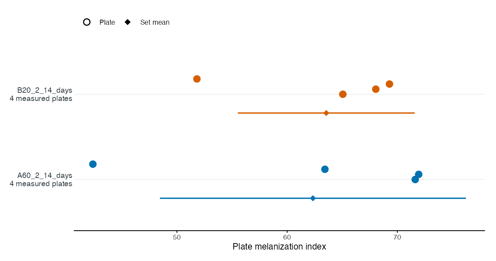

# Real photographs: the complete 14-day workflow

REAL DATA · EIGHT ORIGINAL PHOTOGRAPHS · TWO MATCHING SETS

From the original photograph to a traceable comparison.

A complete practice run with supplied metadata, five spots per target
colony, image QC, matched coefficients, saved tables and
publication-format exports.

Start here after [installing
FunMel](https://mghotbi.github.io/FunMel/articles/FunMel.md). For your
own photographs, use the [Get started
workflow](https://mghotbi.github.io/FunMel/articles/FunMel.md); this
article uses eight fixed example filenames and their supplied design.
Run numbered steps in order; all objects used below are created in this
article. The figures and tables shown here use the bundled photographs.
The [function
catalog](https://mghotbi.github.io/FunMel/articles/Function-examples.md)
covers specialist tools separately.

## What this experiment contains

Each matching set has **one independent control plate and three
independent confrontation plates**. Each plate has four target
*Zymoseptoria tritici* colonies. Confrontation plates also contain a
central fungus and connected hyphal growth; control plates do not. The
central growth is not an inhibition zone.

| Matching set  | Independent plate image | Role                | Replicate |
|---------------|-------------------------|---------------------|-----------|
| A60_2_14_days | 2026_10_02_99_38.JPG    | A60_2 confrontation | 1         |
| A60_2_14_days | 2026_10_02_99_39.JPG    | A60_2 confrontation | 2         |
| A60_2_14_days | 2026_10_02_99_40.JPG    | A60_2 confrontation | 3         |
| A60_2_14_days | 2026_10_02_99_41.JPG    | Own-set control     | 1         |
| B20_2_14_days | 2026_10_02_99_42.JPG    | B20_2 confrontation | 1         |
| B20_2_14_days | 2026_10_02_99_43.JPG    | B20_2 confrontation | 2         |
| B20_2_14_days | 2026_10_02_99_44.JPG    | B20_2 confrontation | 3         |
| B20_2_14_days | 2026_10_02_99_45.JPG    | Own-set control     | 1         |

The folder-derived labels are teaching labels whose biological
identities and assignments must be checked against laboratory records.
The supplied source field `fungus="hm83"` is retained without assigning
an unverified biological role. Unrecorded strain/medium fields remain
blank. The eight original JPEGs are unchanged. No separate image
download is required.

**Units matter.** This is eight plates, 32 target colonies and, when all
requested spots fit, 160 spots. It is not 160 independent biological
replicates. One control per set supports descriptive coefficients, not
the package’s replicated-cell significance tests.

## 1. Locate the photographs and create one practice project

``` r

library(FunMel)
photos14 <- system.file("extdata","14-days",package="FunMel")
stopifnot(nzchar(photos14))
project_dir14 <- tempfile("FunMel_14_day_project_")
project14 <- prepare_experiment(photos14,project_dir14)
```

[`tempfile()`](https://rdrr.io/r/base/tempfile.html) supplies a **new
temporary folder name**, so this teaching run does not overwrite earlier
work. Its files last only as long as the temporary location remains. For
a project you want to keep, replace that assignment **before starting**
with a new durable folder, for example:

``` r

# Alternative to tempfile(): keep the bundled practice project in your home folder.
project_dir14 <- file.path(path.expand("~"), "FunMel_14_day_project")
if (file.exists(file.path(project_dir14, "project.rds"))) {
  project14 <- load_experiment(project_dir14)
} else {
  project14 <- prepare_experiment(input=photos14, project_dir=project_dir14)
}
```

`project_dir14` is the output folder, not the input ZIP. To analyze your
own ZIP, use the separate input/output example in [Get
started](https://mghotbi.github.io/FunMel/articles/FunMel.md).

Do not run both preparation alternatives for the same project. To
revisit work already saved, go directly to step 8. A folder or ZIP is
passed directly here; there is no file chooser and no opportunity to
select a QC image accidentally.

``` r

project14$project_dir   # All output files.
project14$metadata_file # Project copy of the experimental design.
project14$qc_dir        # QC PNGs created by the image run.
```

## 2. Check the supplied metadata

The combined metadata is discovered automatically. Inspect it before
measuring:

``` r

metadata14 <- read.csv(project14$metadata_file,check.names=FALSE)
knitr::kable(metadata14[c("plate_id","set_id","treatment","centre_model","replicate")],
             row.names=FALSE)
```

| plate_id         | set_id        | treatment | centre_model | replicate |
|:-----------------|:--------------|:----------|:-------------|----------:|
| 2026_10_02_99_38 | A60_2_14_days | A60_2     | fungus       |         1 |
| 2026_10_02_99_39 | A60_2_14_days | A60_2     | fungus       |         2 |
| 2026_10_02_99_40 | A60_2_14_days | A60_2     | fungus       |         3 |
| 2026_10_02_99_41 | A60_2_14_days | control   | none         |         1 |
| 2026_10_02_99_42 | B20_2_14_days | B20_2     | fungus       |         1 |
| 2026_10_02_99_43 | B20_2_14_days | B20_2     | fungus       |         2 |
| 2026_10_02_99_44 | B20_2_14_days | B20_2     | fungus       |         3 |
| 2026_10_02_99_45 | B20_2_14_days | control   | none         |         1 |

Each control appears once, labelled `treatment="control"` and
`centre_model="none"`. Each confrontation uses `centre_model="fungus"`.
All four plates in a matching group share their `set_id`. A60_2 never
uses B20_2’s control or vice versa. `replicate` is numbered within a
treatment and set; it does not by itself pair a treatment plate with a
uniquely replicated control. With one control in a set, its mean is the
shared denominator for the three treatment plates.

Verify treatment identities, controls, sets, day and any recorded
strain/medium. Correct missing or inaccurate information. Additional
user-defined columns are preserved. Do not infer biological identities
from a filename alone. If corrections are needed, edit the project CSV
and save it before matched comparisons. Do not change image identity or
layout after analysis without remeasuring.

## 3. Set calibration and measure all eight plates

In this example, `90` is an **illustrative outer dish diameter**, not a
verified physical measurement of these photographs. Replace it with the
actual outer diameter for scientific use. Do not paste subsequent R
commands into a [`readline()`](https://rdrr.io/r/base/readline.html)
prompt; this workflow sets the number directly.

``` r

dish_mm <- 90
result14 <- run_experiment(
  project14,dish_diameter_mm=dish_mm,max_dim=1200,
  n_spots=5,spot_radius_mm=0.4,n_boot=20
)
result14$analysis_status
#> [1] "complete"
result14$failed
#> [1] file  error
#> <0 rows> (or 0-length row.names)
stopifnot(nrow(result14$failed)==0L)
```

The expected status is `"complete"`; the failure table has zero rows.
This saves `image_analysis.rds`, measurement CSVs and a QC PNG for each
plate. A genuine failed image must be corrected before finalization.
Success does not certify segmentation or biological accuracy.

| Setting | Meaning in this tutorial |
|----|----|
| `dish_diameter_mm` | Outer diameter used to convert pixels to millimetres |
| `max_dim=1200` | Longest working-image dimension; influences spatial resolution |
| `n_spots=5` | Request five additional circular regions within each target colony |
| `spot_radius_mm=0.4` | Radius of each spot, not its diameter |
| `n_boot=20` | Quick teaching setting for spatial-block bootstrap summaries, not precise uncertainty |

Whole-colony MI uses eligible interior pixels, excluding the rim and
saturated/specular pixels. Spots add a deterministic, spatially spread
sample; they do not replace whole-colony measurements. Omit spot
settings for whole-colony measurements alone. Use consistent settings
across comparable plates.

``` r

data.frame(plates=nrow(result14$plates),colonies=nrow(result14$colonies),
           spots=nrow(result14$spots),failed=nrow(result14$failed))
#>   plates colonies spots failed
#> 1      8       32   160      0
```

## 4. Inspect masks, spots and illumination

Inspect all eight QC images in `project14$qc_dir`. The examples below
show one confrontation and its own control; they do not replace
reviewing the remaining photographs.


Example QC: a confrontation plate and its own matching control. Inspect
the target outlines, spot locations, central fungal tissue/hyphae and
dish calibration on every image.


Example QC: a confrontation plate and its own matching control. Inspect
the target outlines, spot locations, central fungal tissue/hyphae and
dish calibration on every image.

Check target-colony boundaries, central tissue/hyphal separation, spot
containment, dish edge, shadows, glare and warning text. The
approximately round targets need not have perfectly circular outlines.
Correct unsuitable images or measurements before interpreting the final
comparisons.

``` r

fields14 <- c("plate_id","n_colonies_detected","central_detected","flat_field_status")
qc_table14 <- result14$plates[intersect(fields14,names(result14$plates))]
missing14 <- setdiff(fields14,names(result14$plates))
if(length(missing14)) cat("Not reported: ",paste(missing14,collapse=", "),
                        "; no values were inferred. Inspect QC before interpretation.\n",sep="")
knitr::kable(qc_table14,row.names=FALSE)
```

| plate_id | n_colonies_detected | central_detected | flat_field_status |
|:---|---:|:---|:---|
| 2026_10_02_99_38 | 4 | TRUE | withheld_degenerate_fit |
| 2026_10_02_99_39 | 4 | TRUE | withheld_degenerate_fit |
| 2026_10_02_99_40 | 4 | TRUE | withheld_degenerate_fit |
| 2026_10_02_99_41 | 4 | FALSE | withheld_degenerate_fit |
| 2026_10_02_99_42 | 4 | TRUE | withheld_degenerate_fit |
| 2026_10_02_99_43 | 4 | TRUE | withheld_degenerate_fit |
| 2026_10_02_99_44 | 4 | TRUE | withheld_degenerate_fit |
| 2026_10_02_99_45 | 4 | FALSE | withheld_degenerate_fit |

Read the status recorded in your table. `withheld_degenerate_fit` means
the fitted illumination correction did not pass the saturation safeguard
and was withheld. `NA` or an absent field means **not reported**, not
that correction was applied or passed. The table explicitly identifies
fields not supplied by the analysis. Inspect the QC images and repeat
measurement if QC information is missing. A withheld correction is **not
evidence of adequate illumination**. Treatment/control ratios do not
guarantee cancellation of exposure or lighting differences. Use
consistent imaging and a suitable reference; rephotograph when needed.
The figures here illustrate software output, not a validated
melanin-concentration assay.

Console reminders identify image-QC checks. Inspect the QC images before
interpreting or reporting results.

## 5. Inspect whole-colony, spot and profile tables

``` r

fields14 <- c("plate_id","colony_id","MI_min","MI_mean","MI_max","MI_spot_mean","n_spots_measured","spot_status")
colony_table14 <- result14$colonies[intersect(fields14,names(result14$colonies))]
knitr::kable(head(colony_table14),digits=2,row.names=FALSE)
```

| plate_id | colony_id | MI_min | MI_mean | MI_max | MI_spot_mean | n_spots_measured | spot_status |
|:---|:---|---:|---:|---:|---:|---:|:---|
| 2026_10_02_99_38 | TL | 42.26 | 70.45 | 90.67 | 72.00 | 5 | ok |
| 2026_10_02_99_38 | TR | 41.95 | 72.11 | 95.23 | 71.60 | 5 | ok |
| 2026_10_02_99_38 | BR | 53.71 | 74.29 | 94.55 | 71.19 | 5 | ok |
| 2026_10_02_99_38 | BL | 43.64 | 69.64 | 88.77 | 61.21 | 5 | ok |
| 2026_10_02_99_39 | TL | 40.52 | 71.19 | 93.22 | 71.04 | 5 | ok |
| 2026_10_02_99_39 | TR | 34.74 | 68.28 | 93.39 | 64.63 | 5 | ok |

`MI = 100 - CIELAB L*`; larger values indicate darker tissue. `MI_min`
and `MI_max` are observed whole-colony pixel extrema, not confidence
limits. `MI_spot_mean` is the mean of the individual spot means. The
corresponding `MI_spot_min/max` are extrema of **spot means**, not pixel
extrema.

``` r

fields14 <- c("plate_id","colony_id","spot_id","spot_radius_mm","n_pixels","MI_mean","MI_min","MI_max")
spot_table14 <- result14$spots[intersect(fields14,names(result14$spots))]
knitr::kable(head(spot_table14),digits=2,row.names=FALSE)
```

| plate_id | colony_id | spot_id | spot_radius_mm | n_pixels | MI_mean | MI_min | MI_max |
|:---|:---|---:|---:|---:|---:|---:|---:|
| 2026_10_02_99_38 | TL | 1 | 0.4 | 37 | 71.71 | 63.31 | 85.44 |
| 2026_10_02_99_38 | TL | 2 | 0.4 | 37 | 74.01 | 65.28 | 87.13 |
| 2026_10_02_99_38 | TL | 3 | 0.4 | 37 | 69.63 | 55.06 | 80.29 |
| 2026_10_02_99_38 | TL | 4 | 0.4 | 37 | 68.49 | 59.81 | 78.25 |
| 2026_10_02_99_38 | TL | 5 | 0.4 | 37 | 76.13 | 66.56 | 84.13 |
| 2026_10_02_99_38 | TR | 1 | 0.4 | 37 | 71.61 | 63.28 | 81.61 |

Each spot has a location in working-image pixels (`x_px`, `y_px`), a
physical radius and an achieved pixel count. `L_mean` is mean CIELAB
lightness; spot `MI_mean` is `100-L_mean`. Pixel counts depend on the
scale and working resolution. Check `spot_status` and
`n_spots_measured`; if all requested spots cannot fit without overlap,
the incomplete summary is unavailable instead of invented.

``` r

fields14 <- c("plate_id","colony_id","mid_mm","MI_mean","MI_lo","MI_hi")
profile_table14 <- result14$profiles[intersect(fields14,names(result14$profiles))]
knitr::kable(head(profile_table14),digits=2,row.names=FALSE)
```

| plate_id         | colony_id | mid_mm | MI_mean | MI_lo | MI_hi |
|:-----------------|:----------|-------:|--------:|------:|------:|
| 2026_10_02_99_38 | TL        |   0.25 |   71.19 | 70.28 | 71.88 |
| 2026_10_02_99_38 | TL        |   0.75 |   72.96 | 71.71 | 73.82 |
| 2026_10_02_99_38 | TL        |   1.25 |   68.91 | 67.48 | 70.57 |
| 2026_10_02_99_38 | TL        |   1.75 |   68.08 | 66.74 | 69.64 |
| 2026_10_02_99_38 | TL        |   2.25 |   68.01 | 66.21 | 69.70 |
| 2026_10_02_99_38 | TL        |   2.75 |   69.58 | 66.31 | 71.97 |

Profiles describe darkness from the colony edge inward. Their spatial
bootstrap bounds quantify an image-level sampling procedure, not
biological replication or chemical melanin uncertainty. The low
bootstrap count here is for speed.

The full metadata is in `result14$metadata`; custom column names and
values are retained. Colliding measurement names receive a `metadata_`
prefix only in measurement tables. Do not use
`project14$result_file$spots`: `result_file` is a **filename**, whereas
`result14$spots` is a **data frame**.

## 6. Finalize and verify the own-control arithmetic

``` r

reviewed14 <- FunMel::finish_experiment(project14)
fields14 <- c("set_id","treatment","MI_treatment_mean","MI_control_mean",
              "melanization_coefficient","n_treatment_plates","n_control_plates")
coefficient_table14 <- reviewed14$melanization_coefficient[
  intersect(fields14,names(reviewed14$melanization_coefficient))]
print(knitr::kable(coefficient_table14,digits=3,row.names=FALSE))
```

| set_id | treatment | MI_treatment_mean | MI_control_mean | melanization_coefficient | n_treatment_plates | n_control_plates |
|:---|:---|---:|---:|---:|---:|---:|
| A60_2_14_days | A60_2 | 68.996 | 42.374 | 1.628 | 3 | 1 |
| B20_2_14_days | B20_2 | 67.463 | 51.813 | 1.302 | 3 | 1 |

``` r

reviewed14$assessment$status
```

\[1\] “insufficient_plate_replication”

A plate’s MI is the equally weighted mean of its target-colony `MI_mean`
values. Within each set, the coefficient is:

``` math
\mathrm{MC}_{s,t}=\frac{\operatorname{mean}(\mathrm{MI}_{\text{treatment plates},s,t})}
{\operatorname{mean}(\mathrm{MI}_{\text{control plates},s})}.
```

For this teaching calibration, A60_2 is approximately **1.628** and
B20_2 approximately **1.302**. Verify the saved arithmetic without
pooling controls:

``` r

cf14 <- reviewed14$melanization_coefficient
stopifnot(isTRUE(all.equal(cf14$melanization_coefficient,
                           cf14$MI_treatment_mean/cf14$MI_control_mean)))
knitr::kable(reviewed14$per_plate_coefficients,digits=3,row.names=FALSE)
```

| plate_id | treatment | set_id | MI_treatment_plate | MI_matching_control | melanization_coefficient | n_control_plates | qc_review_status | status |
|:---|:---|:---|---:|---:|---:|---:|:---|:---|
| 2026_10_02_99_38 | A60_2 | A60_2_14_days | 71.621 | 42.374 | 1.690 | 1 | unconfirmed | ok |
| 2026_10_02_99_39 | A60_2 | A60_2_14_days | 71.938 | 42.374 | 1.698 | 1 | unconfirmed | ok |
| 2026_10_02_99_40 | A60_2 | A60_2_14_days | 63.428 | 42.374 | 1.497 | 1 | unconfirmed | ok |
| 2026_10_02_99_42 | B20_2 | B20_2_14_days | 65.057 | 51.813 | 1.256 | 1 | unconfirmed | ok |
| 2026_10_02_99_43 | B20_2 | B20_2_14_days | 68.045 | 51.813 | 1.313 | 1 | unconfirmed | ok |
| 2026_10_02_99_44 | B20_2 | B20_2_14_days | 69.287 | 51.813 | 1.337 | 1 | unconfirmed | ok |

The status `"insufficient_plate_replication"` is expected. There is one
control per set, so significance tests are withheld, while valid
descriptive ratios remain available. Four colonies and five spots per
colony do not add independent control plates. These two treatments also
occur in different sets, so a direct causal treatment ranking may be
confounded with batch. A darker image-based mean is not a demonstrated
fold change in melanin concentration.

For a prespecified spot-mean descriptive response:

``` r

spot_coefficient14 <- melanization_coefficient(reviewed14,response="MI_spot_mean")
```

This changes the response definition; it does not create independent
spot replicates. The default figure and assessment use whole-colony MI.

## 7. Display, export and explain the final figure

``` r

print(plot_treatment_comparison(reviewed14))
```


Descriptive real-data comparison. Each row uses that treatment’s own set
control; these are image-darkness ratios under the illustrative
calibration.

For your own project, a blank plotting result can mean that matching
assignments are incomplete. Check `reviewed14$comparison_status` and
`reviewed14$coefficient_error`. When the status is `awaiting_design`,
[`plot_treatment_comparison()`](https://mghotbi.github.io/FunMel/reference/plot_treatment_comparison.md)
reports why it cannot create a matched comparison; use the set-only plot
later in this article for descriptive measurements. After actual
matching assignments are supplied, finalize again before plotting. Do
not replace missing labels with guessed controls. A plot stored in a
variable must be explicitly printed in a script or loop.

You can also plot the finalized object already in memory:

``` r

print(plot_treatment_comparison(reviewed14))
```

- **Left panel:** independent plate MI means. Squares are controls;
  coloured circles are treatment plates; lower diamonds are treatment
  means.
- **Right panel:** each treatment plate divided by its own set’s control
  mean, and the set-level ratio of means. The dashed reference line is
  MC = 1.
- **Bars and printed ± values:** one between-plate SD, not confidence
  intervals. Control SD is unavailable for a single control. Ratio SD
  conditions on the shared control mean and does not include its
  uncertainty.
- **QC reminders:** remain visible in the console and separate caption
  file; they identify checks to complete before reporting results.

Finalization already exported `treatment_comparison.pdf`, `.svg`, `.png`
and `_statistics.csv` into the project folder. To create a named
alternative:

``` r

plot_treatment_comparison(reviewed14,
  file=file.path(project14$project_dir,"my_14_day_comparison"),
  labels=c(A60_2="Fungal treatment A60_2",B20_2="Fungal treatment B20_2"))
```

PDF and SVG retain vector text and geometry; PNG is 600 dpi. Check the
target journal’s final dimensions, font sizes and caption requirements.
Changing display labels does not change metadata or statistical
matching.

## 8. Close R, reopen the project and read saved tables

For a project saved in a durable folder, start a fresh session and
select its `image_analysis.rds` file. Read saved results directly from
that same folder:

``` r

library(FunMel)
saved_file14 <- file.choose() # Select image_analysis.rds in the project folder.
saved_dir14 <- dirname(normalizePath(saved_file14,mustWork=TRUE))
result14 <- readRDS(file.path(saved_dir14,"image_analysis.rds"))
reviewed14 <- readRDS(file.path(saved_dir14,"reviewed_analysis.rds"))
head(result14$spots)
print(plot_treatment_comparison(reviewed14))
```

This reads existing measurements; it does not repeat image analysis.
Keep the complete project folder so the original and finalized results
remain together.

For project-aware recovery, the optional
[`load_experiment()`](https://mghotbi.github.io/FunMel/reference/load_experiment.md)
and
[`read_experiment()`](https://mghotbi.github.io/FunMel/reference/read_experiment.md)
helpers reconnect moved project paths:

``` r

project14 <- load_experiment() # Select project.rds in its current folder.
result14 <- read_experiment(project14)
reviewed14 <- read_experiment(project14,finalized=TRUE)
```

After opening the project with
[`load_experiment()`](https://mghotbi.github.io/FunMel/reference/load_experiment.md),
update final outputs after correcting valid experimental annotations:

``` r

reviewed14 <- FunMel::finish_experiment(project14)
```

`Final outputs saved` means this succeeded. It is unnecessary to prepare
the photographs again. Keep the complete folder, including project.rds,
metadata CSV and saved results.
[`load_experiment()`](https://mghotbi.github.io/FunMel/reference/load_experiment.md)
reconnects moved internal paths. Saved measurements can be
read/finalized without the original photographs, but a new image run
still needs them. Missing metadata cannot be safely guessed or rebuilt
from image appearance. Changes affecting masks require reanalysis.

## 9. Optional close-up measurements and specialist tools

Batch results keep tables and saved QC PNGs but drop large image arrays.
For interactive image-level views, reprocess just one real photograph
with images retained:

``` r

row14 <- metadata14[metadata14$plate_id=="2026_10_02_99_38",,drop=FALSE]
plate14 <- analyze_plate(file.path(project14$image_root,row14$relative_file),
  id=row14$plate_id,layout=layout_by_treatment(row14),dish_diameter_mm=dish_mm,
  max_dim=1200,n_spots=5,spot_radius_mm=0.4,n_boot=20,keep_images=TRUE)
plot_qc(plate14)
print(plot_profiles(plate14))
plot_melanization_map(plate14,type="2d")
```

The darkness map is not pigment concentration. For a different spot
count/radius,
`sample_colony_spots(plate14,n_spots=3,spot_radius_mm=0.4)` demonstrates
the sampling API; do not change compared responses inconsistently.
Calibration, classifier training and interactive annotation examples are
in the [complete function
catalog](https://mghotbi.github.io/FunMel/articles/Function-examples.md).
A classifier trained on synthetic teaching labels is not validated for
these photographs.

## Find the exported files

| File | Contents |
|----|----|
| project.rds | Saved project paths for project-aware recovery |
| plate_metadata.csv | Editable experimental assignments, one row per plate |
| image_analysis.rds | Original measured tables and analysis status |
| colonies.csv, spots.csv, profiles.csv, plates.csv | Measurement tables |
| failed.csv | Failed-image reports; zero rows on a successful run |
| metadata_used.csv | Full metadata attached to the outputs |
| reviewed_analysis.rds | Finalized result; the name does not certify review |
| assessment.rds | Statistical/descriptive assessment and its status |
| melanization_coefficient.csv | Own-set ratios of treatment/control means |
| per_plate_coefficients.csv | Treatment plate ratios using own-set control means |
| coefficient_plate_means.csv | Independent plate means used in calculations |
| treatment_comparison.pdf/.svg/.png | Comparison exports |
| treatment_comparison_statistics.csv | Exact descriptive values plotted |
| treatment_comparison_caption.txt | Full interpretation, SD definitions, limitations and QC status |
| qc_review_status.csv | Recorded QC status |
| qc/ | One QC PNG per image |
| sessionInfo.txt | R, platform and package versions |

Different recorded day/strain/medium contexts create separate final
output folders and `context_index.csv`; do not pool incompatible
contexts. For your own photographs, follow the [Get started
workflow](https://mghotbi.github.io/FunMel/articles/FunMel.md) with your
folder or ZIP and correct segmentation layouts. Keep its own image
identities and experimental assignments. This article’s filenames and
numerical results refer only to the eight supplied photographs.

The installed script `examples/walkthrough_14_days.R` follows the same
numbered procedure. Precomputed tables in `extdata/14_day_example` are
documented in their `PROVENANCE.md`. The steps above analyze the
original photographs.

Comparison captions are exported separately as
`treatment_comparison_caption.txt`. Use `caption="brief"` or
`caption="full"` in
[`plot_treatment_comparison()`](https://mghotbi.github.io/FunMel/reference/plot_treatment_comparison.md)
to include a caption beneath the figure.

## Using your own photographs without completing experimental labels

The bundled example has matching labels already supplied, so it produces
matched coefficients. Your own photographs can be measured even when
treatment, set and optional annotations are blank. Prepare a new
project, then run it directly. Unlabeled rows use the standard fungal
layout; use `default_centre="none"` for control-only photographs. Mixed
collections require the correct per-image `centre_model` or known
control labels so the appropriate layout is used.

Finalization with an incomplete matching design saves measurements with
`comparison_status="awaiting_design"` and an explanation in
`comparison_status.csv`. It does not generate an unsupported comparison
figure. Complete the actual treatment and own-control set assignments
only when you need comparisons, then finish again. Do not remeasure
unless the image layout changes. No optional strain, medium, date, notes
or approval flags need filling merely to measure images. Inspect QC
before interpretation. All displayed table examples use base R and
[`knitr::kable()`](https://rdrr.io/pkg/knitr/man/kable.html); no hidden
tutorial helper needs to be copied. You can also use
`head(result$colonies)` to inspect measurements immediately.

## Explore measurements by set, without treatment names

You can inspect measurements using only `set_id` and the image
identities. You do not need to name the treatments, fill optional
annotations or change approval flags. These commands work after
[`run_experiment()`](https://mghotbi.github.io/FunMel/reference/run_experiment.md);
they do not require a completed coefficient calculation. For your own
ZIP, first run the standalone workflow below, then use its `result14`
and `project14` objects here.

First, count the photographs recorded in each set:

``` r

metadata14 <- read.csv(project14$metadata_file, check.names=FALSE)
knitr::kable(as.data.frame(table(metadata14$set_id)),
             col.names=c("Set", "Photographs"), row.names=FALSE)
```

| Set           | Photographs |
|:--------------|------------:|
| A60_2_14_days |           4 |
| B20_2_14_days |           4 |

Next, average the finite colony measurements within each independent
plate, then summarize those plate means by set. Each plate receives
equal weight; colonies and spots are subsamples rather than independent
plate replicates. Inspect the QC images and resolve failed photographs
before interpretation. Keep different days, strains, media and other
experimental contexts separate; subset the colony table to a single
context before running this summary if those contexts occur within the
same set.

``` r

colony_table14 <- result14$colonies
usable14 <- colony_table14[
  is.finite(colony_table14$MI_mean) &
    !is.na(colony_table14$set_id) & nzchar(trimws(colony_table14$set_id)),
  c("set_id", "plate_id", "MI_mean")
]
plate_means14 <- aggregate(MI_mean ~ set_id + plate_id,
                           data=usable14, FUN=mean)
knitr::kable(plate_means14, digits=3, row.names=FALSE)
```

| set_id        | plate_id         | MI_mean |
|:--------------|:-----------------|--------:|
| A60_2_14_days | 2026_10_02_99_38 |  71.621 |
| A60_2_14_days | 2026_10_02_99_39 |  71.938 |
| A60_2_14_days | 2026_10_02_99_40 |  63.428 |
| A60_2_14_days | 2026_10_02_99_41 |  42.374 |
| B20_2_14_days | 2026_10_02_99_42 |  65.057 |
| B20_2_14_days | 2026_10_02_99_43 |  68.045 |
| B20_2_14_days | 2026_10_02_99_44 |  69.287 |
| B20_2_14_days | 2026_10_02_99_45 |  51.813 |

``` r


set_means14 <- aggregate(MI_mean ~ set_id, data=plate_means14, FUN=mean)
plate_counts14 <- aggregate(plate_id ~ set_id, data=plate_means14, FUN=length)
names(plate_counts14)[2] <- "n_measured_plates"
set_summary14 <- merge(set_means14, plate_counts14, by="set_id")
names(set_summary14)[names(set_summary14)=="MI_mean"] <- "mean_plate_MI"
knitr::kable(set_summary14, digits=3, row.names=FALSE)
```

| set_id        | mean_plate_MI | n_measured_plates |
|:--------------|--------------:|------------------:|
| A60_2_14_days |         62.34 |                 4 |
| B20_2_14_days |         63.55 |                 4 |

You can plot those plate means without assigning treatment names:

``` r

# Keep individual plates visible; use the final figure's colours and typography.
set_order14 <- sort(unique(as.character(plate_means14$set_id)))
set_palette14 <- stats::setNames(
  rep(c("#0072B2", "#D55E00", "#009E73", "#CC79A7", "#E69F00", "#56B4E9"),
      length.out=length(set_order14)), set_order14)
if (length(set_order14)>6L)
  set_palette14 <- stats::setNames(
    grDevices::hcl.colors(length(set_order14), "Dark 3"), set_order14)

points14 <- plate_means14[order(plate_means14$set_id, plate_means14$plate_id), ]
points14$row <- match(points14$set_id, set_order14)
for (set14 in set_order14) {
  ix14 <- which(points14$set_id==set14)
  points14$row[ix14] <- points14$row[ix14] +
    if (length(ix14)>1L) seq(0, 0.18, length.out=length(ix14)) else 0.08
}
set_sd14 <- aggregate(MI_mean ~ set_id, data=plate_means14, FUN=stats::sd)
names(set_sd14)[2] <- "sd_plate_MI"
summary_plot14 <- merge(set_summary14, set_sd14, by="set_id")
summary_plot14$row <- match(summary_plot14$set_id, set_order14)-0.22
intervals14 <- summary_plot14[is.finite(summary_plot14$sd_plate_MI), ]
labels14 <- paste0(set_order14, "\n",
  summary_plot14$n_measured_plates[match(set_order14, summary_plot14$set_id)],
  " measured plates")

set_plot14 <- ggplot2::ggplot(points14, ggplot2::aes(x=MI_mean, y=row)) +
  ggplot2::geom_segment(data=intervals14, ggplot2::aes(
    x=mean_plate_MI-sd_plate_MI, xend=mean_plate_MI+sd_plate_MI,
    y=row, yend=row, colour=set_id), inherit.aes=FALSE, linewidth=0.65) +
  ggplot2::geom_point(ggplot2::aes(colour=set_id, fill=set_id, shape="Plate"),
                      size=2.6, stroke=0.8) +
  ggplot2::geom_point(data=summary_plot14, ggplot2::aes(
    x=mean_plate_MI, y=row, colour=set_id, fill=set_id, shape="Set mean"),
    inherit.aes=FALSE, size=2.7) +
  ggplot2::scale_colour_manual(values=set_palette14, guide="none") +
  ggplot2::scale_fill_manual(values=set_palette14, guide="none") +
  ggplot2::scale_shape_manual(values=c("Plate"=21, "Set mean"=18)) +
  ggplot2::scale_y_continuous(breaks=seq_along(set_order14), labels=labels14,
    limits=c(0.5, length(set_order14)+0.5)) +
  ggplot2::labs(x="Plate melanization index", y=NULL, shape=NULL) +
  ggplot2::theme_classic(base_size=9, base_family="sans") +
  ggplot2::theme(
    axis.line.y=ggplot2::element_blank(), axis.ticks.y=ggplot2::element_blank(),
    axis.text=ggplot2::element_text(colour="#263238"),
    axis.text.y=ggplot2::element_text(size=8),
    panel.grid.major.y=ggplot2::element_line(colour="#E8ECEE", linewidth=0.3),
    legend.position="top", legend.justification="left",
    plot.margin=ggplot2::margin(10, 12, 10, 10))
print(set_plot14)
```



Circles show individual plates; the lower diamond shows the set mean.
Bars show one between-plate SD, not confidence intervals, and are
unavailable for a single plate. Colours identify sets, not treatment or
control roles. This optional descriptive plot complements the two-panel
matched-control figure in step 7; it does not replace it or infer
treatment effects, coefficients or p-values. There is no caption
embedded beneath either figure by default.

The plot displays in R and in this article. To save this optional
figure, run:

``` r

for (ext14 in c("pdf", "svg", "png")) {
  ggplot2::ggsave(file.path(project14$project_dir,
                          paste0("set_measurements.", ext14)),
                 plot=set_plot14, width=7.2, height=3.8, dpi=600, bg="white",
                 device=if (ext14=="svg") grDevices::svg else
                   if (ext14=="pdf") grDevices::cairo_pdf else "png")
}
```

These are **descriptive summaries of all measured plates in each set**.
If a set contains both control and confrontation plates, this summary
includes both; it does not estimate the response to the interacting
fungus. Blank set IDs are omitted, and plates without finite colony
measurements are not counted. The count of successfully measured plates
can therefore differ from the number of photographs in the metadata.
Means based on incomplete colony detection need inspection as well.

`set_id` groups photographs but cannot identify which member is the
control. For matched melanization coefficients, record the actual
control in each set as `treatment="control"` and identify the other
plates with a treatment code. A short code such as `A60_2` is
sufficient; a descriptive organism name is not required. Confirm the
appropriate per-image layout, including `centre_model="none"` for
control plates. If the layout changes, remeasure; otherwise save the
assignments and run `finish_experiment(project14)` again. Without those
assignments, `awaiting_design` is expected: measurements are available,
but coefficient and treatment-comparison tables remain empty. Do not
call
[`melanization_coefficient()`](https://mghotbi.github.io/FunMel/reference/melanization_coefficient.md)
until the matching design is complete.

## Standalone alternative: analyze your own 14-day ZIP

Use this complete alternative for your own archive, rather than mixing
it with the eight-photo example above. The ZIP is the input file; the
project directory is a separate new output folder. It must not be inside
the ZIP filename. Do not rerun preparation over an existing project;
reopen its `project.rds` with
[`load_experiment()`](https://mghotbi.github.io/FunMel/reference/load_experiment.md)
instead, or choose a new output folder.

``` r

library(FunMel)
photo_zip14 <- path.expand("~/Desktop/photos_14_days.zip")
project_dir14 <- path.expand("~/Desktop/FunMel_14_day_project")

# Reopen a prepared project; otherwise create it once from the ZIP.
if (file.exists(file.path(project_dir14, "project.rds"))) {
  project14 <- load_experiment(project_dir14)
} else {
  project14 <- prepare_experiment(
    input = photo_zip14,
    project_dir = project_dir14
  )
}

# Read existing measurements, or measure if this project has none yet.
if (file.exists(project14$result_file) || file.exists(project14$reviewed_file)) {
  result14 <- read_experiment(project14)
} else {
  # Replace 90 with the verified outer diameter of your dishes (mm).
  result14 <- run_experiment(
    project14, dish_diameter_mm=90,
    n_spots=5, spot_radius_mm=0.4
  )
}
result14$failed
head(result14$colonies)
head(result14$spots)
project14$qc_dir # Inspect all saved QC images before interpreting results.

# After resolving any failed photographs:
reviewed14 <- finish_experiment(project14)
reviewed14$comparison_status
comparison14 <- plot_treatment_comparison(reviewed14)
if (!is.null(comparison14)) print(comparison14)
project14$project_dir # Saved tables, analyses and any eligible comparison figures.
```

The two paths have different roles: `photo_zip14` is the existing
photograph ZIP, and `project_dir14` is the output folder. `"~"` means
your home folder;
[`path.expand()`](https://rdrr.io/r/base/path.expand.html) converts it
to a full path. [`file.path()`](https://rdrr.io/r/base/file.path.html)
joins folder names; it does not extract a ZIP or turn a ZIP file into a
directory.

The block above can be rerun: it reopens `project.rds` when present and
reads saved measurements when available. To import a different ZIP,
choose a new output folder; reopening an existing project keeps that
project’s photographs and metadata. To change the segmentation layout,
dish scale or spot settings, call
[`run_experiment()`](https://mghotbi.github.io/FunMel/reference/run_experiment.md)
explicitly with the intended settings to replace the saved image
measurements, then inspect the new QC and finalize again.

If the output folder is nonempty but has no `project.rds`, keep its
contents and choose another new output folder; do not delete results to
bypass the check. A failed assignment such as
`project14 <- prepare_experiment(...)` does not clear or update an older
`project14` object. If preparation reports an existing project, reopen
its actual folder:

``` r

project14 <- load_experiment(path.expand("~/Desktop/FunMel_14_day_project"))
project14$project_dir
```

Replace the input ZIP path with the actual location on your computer. A
file chooser is an alternative: `photo_zip14 <- file.choose()`. The
example paths above use the macOS Desktop; on other systems supply the
correct full paths or use the chooser and a new output folder under
`path.expand("~")`. The `project14` object from this block refers to
your own archive, not the bundled eight-photo example. Its photographs
can have any supported filenames; do not reuse the bundled example’s
fixed QC-image names or expected coefficients.

Treatment, set and optional annotations can stay blank for measurement.
The fallback is a fungal confrontation layout. For unlabeled
control-only images, add `default_centre="none"` to
[`run_experiment()`](https://mghotbi.github.io/FunMel/reference/run_experiment.md).
Mixed collections require correct per-image `centre_model` values or
verified control labels/folders. No manual approval flags or separate
validation call are needed. Missing matching assignments produce
measurement-only outputs with `awaiting_design`; add the real
own-control assignments only when comparisons are needed. All metadata
columns are preserved. Do not interpret a successful run as automatic
biological validation; check masks, layouts, calibration and warnings.
